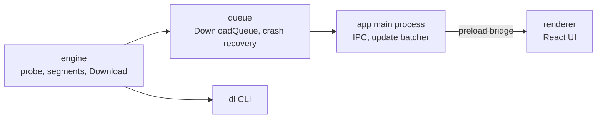

# Fetchdeck

Parallel download manager for desktop.

- Segmented downloads (up to 8 parallel connections)
- Pause, resume, retry, and a queue (3 at a time)
- Crash recovery: kill the app mid-download and resume with a byte-identical file
- Engine written from scratch in Node, UI in Electron + React

## Architecture



The engine has no UI dependency, so the same code powers the CLI and the desktop app. The renderer has no Node access and talks to the main process through a small `window.downloads` bridge.

## Benchmark

32 MiB from a local fake server, each connection capped at 1 MiB/s (`npm run bench`):

| Scenario | Seconds | MB/s |
|---|---|---|
| 1 segment | 32.3 | 1.0 |
| 8 segments, no stealing | 4.0 | 7.9 |
| 8 segments, stealing | 4.0 | 7.9 |
| 8 segments, first one slow (256 KiB/s), no stealing | 16.1 | 2.0 |
| 8 segments, first one slow (256 KiB/s), stealing | 7.0 | 4.5 |

With even connections, stealing changes nothing. When one connection is slow, finished workers take over half of its remaining bytes, which cut the time by more than half.

## Design decisions

See [DECISIONS.md](DECISIONS.md). In short: segments write at their own offsets into one pre-sized file, range support is verified with a real `206`, the ETag is checked before resuming, and the file is synced to disk before the record that describes it is saved.

## Using it

```bash
npm install
npm run dev -w app          # desktop app
npx tsx engine/cli/dl.ts <url> [--dir <folder>] [--segments <n>]
```

`dl` shows a live progress line. Press Ctrl+C to pause; running the same command again resumes.

## Tests

```bash
npm run check   # lint, type-check, all tests
```

Tests run against a fake HTTP server that can misbehave on demand: ignoring `Range`, dropping connections, failing with 503, expiring links, throttling. The crash test kills a child process with `SIGKILL` mid-download and checks that the resumed file is byte-identical.

## Known limits

- HTTP and HTTPS only. No cookies or authentication, so links that need a login won't work.
- A server that doesn't support `Range` downloads as one stream, and pausing restarts it from zero.
- No speed limit, scheduling, checksums or browser extension yet.
- The Electron app has been built and unit tested, but not launched in this repo's CI yet.
