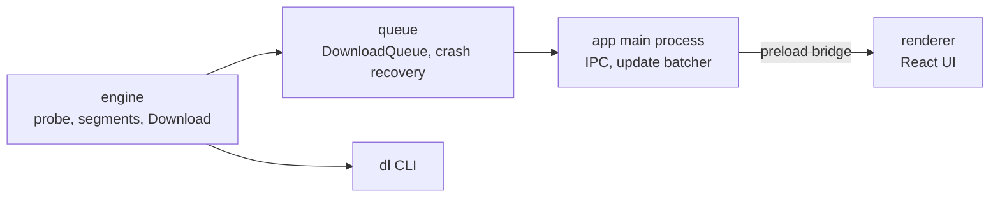

# Fetchdeck

Parallel download manager for desktop.

- Segmented downloads (up to 8 parallel connections)
- Pause, resume, retry, and a queue (3 at a time)
- Crash recovery: kill the app mid-download and resume with a byte-identical file
- Engine written from scratch in Node, UI in Electron + React
- Chrome and Edge extension that hands browser downloads to Fetchdeck, including downloads that need a login

## Architecture



The engine has no UI dependency, so the same code powers the CLI and the desktop app. The renderer has no Node access and talks to the main process through a small `window.downloads` bridge.

## Benchmark

32 MiB from a local fake server, each connection capped at 1 MiB/s (`npm run bench`):

| Scenario | Seconds | MB/s |
|---|---|---|
| 1 segment | 32.3 | 1.0 |
| 8 segments, no stealing | 4.0 | 7.9 |
| 8 segments, stealing | 4.0 | 7.9 |
| 8 segments, first one slow (256 KiB/s), no stealing | 16.1 | 2.0 |
| 8 segments, first one slow (256 KiB/s), stealing | 7.0 | 4.5 |

With even connections, stealing changes nothing. When one connection is slow, finished workers take over half of its remaining bytes, which cut the time by more than half.

## Design decisions

The full design is in [docs/design-spec.md](docs/design-spec.md), and [docs/build-guide.md](docs/build-guide.md) is the step-by-step guide it was built from. Choices that came up along the way are in [DECISIONS.md](DECISIONS.md), and release notes are in [CHANGELOG.md](CHANGELOG.md). In short: segments write at their own offsets into one pre-sized file, range support is verified with a real `206`, the ETag is checked before resuming, and the file is synced to disk before the record that describes it is saved.

## Running it

You need Node 22.12 or newer. Install dependencies first:

```bash
npm install
```

### Command-line tool

```bash
npx tsx engine/cli/dl.ts <url> [--dir <folder>] [--segments <n>]
```

`dl` shows a live progress line. Press Ctrl+C to pause; running the same command again resumes.

### Desktop app

npm blocks install scripts by default, so the Electron binary isn't downloaded by `npm install`. Fetch it once (about 100 MB):

```bash
node node_modules/electron/install.js
```

Then start the app:

```bash
npm run dev -w app
```

Only one instance of the app runs at a time; launching it again focuses the open window. Downloads go to your system Downloads folder unless you choose another one in Settings. The app keeps its state in Electron's user-data folder.

On Linux, if Electron exits with a sandbox error, run it once with `--no-sandbox` or fix the permissions on `node_modules/electron/dist/chrome-sandbox`.

### Installers

```bash
npm run dist
```

This builds an AppImage and a `.deb` on Linux, or an NSIS installer on Windows, into `app/release/`. electron-builder downloads extra Electron files on its first run.

### Windows SmartScreen

The installer is not code-signed, so Windows SmartScreen may show "Windows protected your PC" the first time you run it. That is expected for an unsigned app. To continue, click **More info**, then **Run anyway**. If you want to check the download first, compare its SHA-256 with the `SHA256SUMS-Windows.txt` file attached to the same release (`Get-FileHash .\Fetchdeck-Setup-1.2.0.exe`).

## Browser extension

The extension catches downloads in Chrome and Edge and hands them to Fetchdeck, like a download manager's browser add-on. It does three things:

- **Large downloads are captured automatically.** Any `http(s)` download with a known size of 5 MB or more (adjustable in the extension's options) is paused in the browser, and Fetchdeck opens its Add dialog with the link filled in. **Download** takes it over; **Download in browser** (or Esc) lets the browser carry on where it paused.
- **Right-click a link, then "Download with Fetchdeck".** This works for any link, whatever its size.
- **Logged-in downloads work.** The extension sends the site's cookies, the page you came from and your browser's user agent, so links that need a login download the way they would in the browser. Fetchdeck sends the cookies only to the site they belong to, keeps them encrypted on disk, and deletes them when the download finishes, is cancelled or is removed. A download that failed keeps them so Retry works. If your system has no keyring to encrypt with, they stay in memory only, and a download resumed after a restart asks for the link from your browser again.

### Install

1. In Fetchdeck, open **Settings** and turn on **Browser extension**. It is off by default. Fetchdeck then listens on `127.0.0.1:47600`, which only your own computer can reach.
2. Get the extension: build it with `npm run build -w extension` and use the `extension/dist` folder, or unzip `Fetchdeck-Extension-<version>.zip` from the release page (its SHA-256 is attached next to it).
3. Open `chrome://extensions` (or `edge://extensions`), turn on **Developer mode**, click **Load unpacked** and pick the folder.
4. In Fetchdeck's Settings, click **Copy** next to the pairing token. In the extension's **Options** page, paste it and click **Test connection**. It should say "Connected".

Every request to the local server must carry the pairing token and come from the extension; a web page cannot read the token or talk to the server. **Regenerate** in Settings makes the old token stop working at once.

### The `<all_urls>` permission

Reading a site's cookies needs access to all sites, so the extension asks for the `<all_urls>` host permission, plus `downloads`, `contextMenus`, `storage` and `cookies`. That is a broad permission, acceptable for an unpacked extension you built or checked yourself, and it should be revisited before any store listing. The extension reads cookies only when it hands a download to Fetchdeck, and sends them only to `127.0.0.1:47600`.

### Known limits

- Chrome and Edge only. There is no Firefox build, no store listing and no automatic update; to update, load the new folder.
- The extension watches downloads, not clicks, so there is no Alt-to-bypass. Use the toolbar switch (the badge says "off" while capture is disabled) or **Download in browser**.
- A download that comes from a POST or a form is fetched again as a plain GET and may not work; the preview in the dialog shows the real file before you confirm. One-time and signed links can be used up by the browser's first request.
- Downloads with an unknown size stay in the browser.
- If Fetchdeck is closed, the token is wrong or the app does not answer, the browser download carries on by itself. Nothing is lost.
- If the browser stops the extension while a capture is waiting, the paused download carries on when the extension next starts (for example when you open its popup or start another download). If you had already confirmed it in Fetchdeck by then, the file is downloaded twice.
- Regenerating the token while a capture is waiting does not end that wait at once; the browser download carries on within about 20 seconds.
- A cookie header over 8 KB is refused by Fetchdeck, and that download goes to the browser.

## Tests

```bash
npm run check   # lint, type-check, all tests
```

Tests run against a fake HTTP server that can misbehave on demand: ignoring `Range`, dropping connections, failing with 503, expiring links, throttling. The crash test kills a child process with `SIGKILL` mid-download and checks that the resumed file is byte-identical.

## Not in v1

- Speed limiting
- A first-run screen
- Per-connection speeds

## Known limits

- Only one instance of the desktop app runs at a time.
- HTTP and HTTPS only. Links that need a login work only through the browser extension, which passes along the cookies.
- A server that doesn't support `Range` downloads as one stream, and pausing restarts it from zero.
- No speed limit or per-connection speeds (see "Not in v1"). No scheduling or checksums either.
- The Electron app is unit tested, and CI builds it and launches it once (a smoke test on Linux and Windows); there are no automated end-to-end tests of the window yet. The extension has its own end-to-end test in a real Chromium (`npm run test:e2e -w extension`, after `npx playwright install chromium`); it is not part of `npm run check`.

## License

[MIT](LICENSE)
