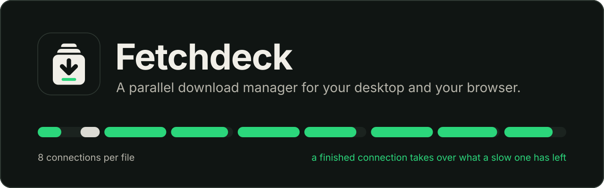
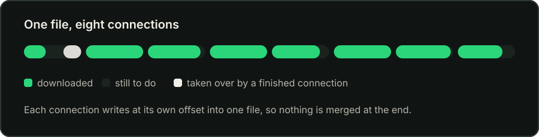
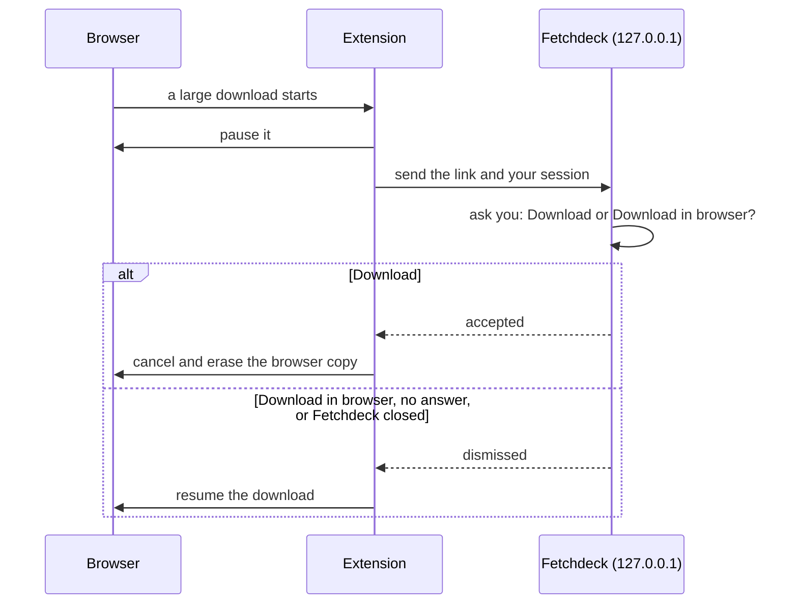
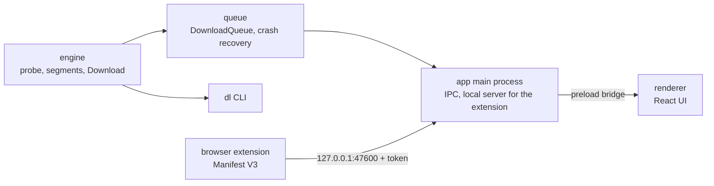
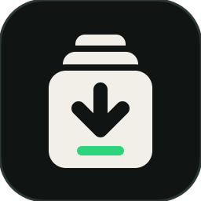

<div align="center">



<br>

[](https://github.com/tejaswasnik/Fetchdeck/releases)
[](#download)
[](#browser-extension)
[](#how-its-built)
[](LICENSE)

**[Download](#download)** &nbsp;·&nbsp; **[Browser extension](#browser-extension)** &nbsp;·&nbsp; **[Benchmark](#benchmark)** &nbsp;·&nbsp; **[Run from source](#run-it-from-source)** &nbsp;·&nbsp; **[Changelog](CHANGELOG.md)**

</div>

<br>

## Big files, finished sooner

Most servers cap the speed of a single connection. Fetchdeck opens up to eight at once, each fetching its own slice of the file, and puts the pieces together as they land. If one connection is slow, a connection that has finished takes over half of what the slow one has left.

<div align="center">

</div>

<br>

<table>
<tr>
<td width="76" valign="top"></td>
<td valign="top"><b>Up to 8 parallel connections</b><br>Each file is split into segments that download at the same time, and the segments that finish early help the ones that lag behind.</td>
<td width="76" valign="top"></td>
<td valign="top"><b>Pause, resume, retry</b><br>Stop a download and pick it up later from the same byte. If the file changed on the server in the meantime, Fetchdeck notices and starts over instead of splicing two versions.</td>
</tr>
<tr>
<td valign="top"></td>
<td valign="top"><b>A queue you control</b><br>Three downloads run at a time by default (1 to 6 in Settings). Move items up and down, or press Start now to jump the line.</td>
<td valign="top"></td>
<td valign="top"><b>Survives crashes</b><br>Kill the app mid-download and resume with a byte-identical file. Progress is saved only after the bytes are safely on disk.</td>
</tr>
<tr>
<td valign="top"></td>
<td valign="top"><b>Catches browser downloads</b><br>A Chrome and Edge extension hands large downloads to Fetchdeck, or any link from the right-click menu.</td>
<td valign="top"></td>
<td valign="top"><b>Works behind a login</b><br>The extension passes your session along, so downloads that need you to be signed in still work. Cookies stay encrypted and are deleted when the download is done.</td>
</tr>
</table>

<br>

## Download

Get the latest build from the **[Releases page](https://github.com/tejaswasnik/Fetchdeck/releases)**.

| You want | Get this file |
|---|---|
| The app for Windows | `Fetchdeck-Setup-<version>.exe` |
| The app for Linux | `Fetchdeck-<version>.AppImage` or `Fetchdeck-<version>.deb` |
| The browser extension (Chrome, Edge) | `Fetchdeck-Extension-<version>.zip` |
| To check a download | the `SHA256SUMS` files and `Fetchdeck-Extension-<version>.zip.sha256` on the same page |

<details>
<summary><b>Windows says "Windows protected your PC"</b></summary>

<br>

The installer is not code-signed, so Windows SmartScreen shows this the first time you run it. That is expected for an unsigned app. Click **More info**, then **Run anyway**.

To check the download first, compare its SHA-256 with the `SHA256SUMS-Windows.txt` file attached to the same release:

```powershell
Get-FileHash .\Fetchdeck-Setup-1.2.0.exe
```

</details>

<br>

## Browser extension


The extension catches downloads in Chrome and Edge and hands them to Fetchdeck, like the add-on of a classic download manager. It does three things:

<br>

- **Large downloads are captured automatically.** Any `http(s)` download with a known size of 5 MB or more (adjustable in the extension's options) is paused in the browser, and Fetchdeck opens its Add dialog with the link filled in. **Download** takes it over. **Download in browser** (or Esc) lets the browser carry on where it paused.
- **Right-click a link, then "Download with Fetchdeck".** This works for any link, whatever its size.
- **Logged-in downloads work.** The extension sends the site's cookies, the page you came from and your browser's user agent. Fetchdeck sends the cookies only to the site they belong to, keeps them encrypted on disk, and deletes them when the download finishes, is cancelled or is removed. A failed download keeps them so Retry works. If your system has no keyring to encrypt with, they stay in memory only, and a download resumed after a restart asks for the link from your browser again.



If anything goes wrong, the browser download carries on by itself. Nothing is lost.

### Install the extension

| | |
|---|---|
| **1** | In Fetchdeck, open **Settings** and turn on **Browser extension**. It is off by default. Fetchdeck then listens on `127.0.0.1:47600`, which only your own computer can reach. |
| **2** | Get the extension: unzip `Fetchdeck-Extension-<version>.zip` from the [Releases page](https://github.com/tejaswasnik/Fetchdeck/releases), or build it yourself with `npm run build -w extension` and use the `extension/dist` folder. |
| **3** | Open `chrome://extensions` (or `edge://extensions`), turn on **Developer mode**, click **Load unpacked** and pick the folder. |
| **4** | In Fetchdeck's Settings, click **Copy** next to the pairing token. In the extension's **Options** page, paste it and click **Test connection**. It should say "Connected". |

Every request to the local server must carry the pairing token and come from the extension. A web page cannot read the token or talk to the server. **Regenerate** in Settings makes the old token stop working at once.

<details>
<summary><b>The <code>&lt;all_urls&gt;</code> permission</b></summary>

<br>

Reading a site's cookies needs access to all sites, so the extension asks for the `<all_urls>` host permission, plus `downloads`, `contextMenus`, `storage` and `cookies`. That is a broad permission, acceptable for an unpacked extension you built or checked yourself, and it should be revisited before any store listing. The extension reads cookies only when it hands a download to Fetchdeck, and sends them only to `127.0.0.1:47600`.

</details>

<details>
<summary><b>Extension limits</b></summary>

<br>

- Chrome and Edge only. There is no Firefox build, no store listing and no automatic update; to update, load the new folder.
- The extension watches downloads, not clicks, so there is no Alt-to-bypass. Use the toolbar switch (the badge says "off" while capture is disabled) or **Download in browser**.
- A download that comes from a POST or a form is fetched again as a plain GET and may not work; the preview in the dialog shows the real file before you confirm. One-time and signed links can be used up by the browser's first request.
- Downloads with an unknown size stay in the browser.
- If Fetchdeck is closed, the token is wrong or the app does not answer, the browser download carries on by itself.
- If the browser stops the extension while a capture is waiting, the paused download carries on when the extension next starts (for example when you open its popup or start another download). If you had already confirmed it in Fetchdeck by then, the file is downloaded twice.
- Regenerating the token while a capture is waiting does not end that wait at once; the browser download carries on within about 20 seconds.
- A cookie header over 8 KB is refused by Fetchdeck, and that download goes to the browser.

</details>

<br>

## Benchmark


32 MiB from a local fake server, each connection capped at 1 MiB/s (`npm run bench`):

<br>

| Scenario | Seconds | MB/s |
|---|---|---|
| 1 segment | 32.3 | 1.0 |
| 8 segments, no stealing | 4.0 | 7.9 |
| 8 segments, stealing | 4.0 | 7.9 |
| 8 segments, first one slow (256 KiB/s), no stealing | 16.1 | 2.0 |
| 8 segments, first one slow (256 KiB/s), stealing | 7.0 | 4.5 |

With even connections, stealing changes nothing. When one connection is slow, finished workers take over half of its remaining bytes, which cut the time by more than half.

<br>

## How it's built


The engine has no UI dependency, so the same code powers the CLI and the desktop app. The renderer has no Node access and talks to the main process through a small bridge.

<br>



In short: segments write at their own offsets into one pre-sized file, range support is verified with a real `206`, the ETag is checked before resuming, and the file is synced to disk before the record that describes it is saved. The full design is in [docs/design-spec.md](docs/design-spec.md), and [docs/build-guide.md](docs/build-guide.md) is the step-by-step guide it was built from. Choices that came up along the way are in [DECISIONS.md](DECISIONS.md).

<br>

## Run it from source

You need Node 22.12 or newer. Install dependencies first:

```bash
npm install
```

**Command-line tool**

```bash
npx tsx engine/cli/dl.ts <url> [--dir <folder>] [--segments <n>]
```

`dl` shows a live progress line. Press Ctrl+C to pause; running the same command again resumes.

**Desktop app**

npm blocks install scripts by default, so the Electron binary isn't downloaded by `npm install`. Fetch it once (about 100 MB):

```bash
node node_modules/electron/install.js
```

Then start the app:

```bash
npm run dev -w app
```

Only one instance of the app runs at a time; launching it again focuses the open window. Downloads go to your system Downloads folder unless you choose another one in Settings. The app keeps its state in Electron's user-data folder.

On Linux, if Electron exits with a sandbox error, run it once with `--no-sandbox` or fix the permissions on `node_modules/electron/dist/chrome-sandbox`.

**Installers**

```bash
npm run dist
```

This builds an AppImage and a `.deb` on Linux, or an NSIS installer on Windows, into `app/release/`. electron-builder downloads extra Electron files on its first run.

**Tests**

```bash
npm run check   # lint, type-check, all tests
```

Tests run against a fake HTTP server that can misbehave on demand: ignoring `Range`, dropping connections, failing with 503, expiring links, throttling. The crash test kills a child process with `SIGKILL` mid-download and checks that the resumed file is byte-identical. CI also builds the app and launches it once on Linux and Windows. The extension has its own end-to-end test in a real Chromium (`npm run test:e2e -w extension`, after `npx playwright install chromium`); it is not part of `npm run check`.

<br>

## Not in v1

- Speed limiting
- A first-run screen
- Per-connection speeds
- Scheduling and checksums

## Known limits

- Only one instance of the desktop app runs at a time.
- HTTP and HTTPS only. Links that need a login work only through the browser extension, which passes along the cookies.
- A server that doesn't support `Range` downloads as one stream, and pausing restarts it from zero.
- The Electron app is unit tested, and CI builds it and launches it once (a smoke test on Linux and Windows); there are no automated end-to-end tests of the window yet.

<br>

<div align="center">



**Fetchdeck** · made by [Tejas Wasnik](https://github.com/tejaswasnik) · [MIT License](LICENSE)

</div>
