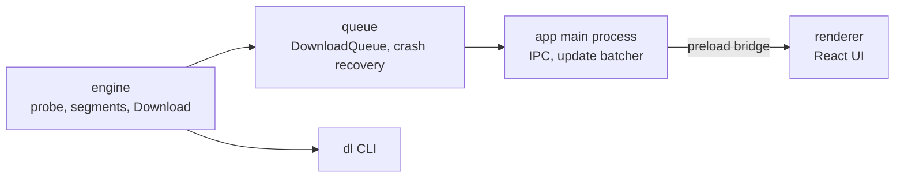

# Fetchdeck

Parallel download manager for desktop.

- Segmented downloads (up to 8 parallel connections)
- Pause, resume, retry, and a queue (3 at a time)
- Crash recovery: kill the app mid-download and resume with a byte-identical file
- Engine written from scratch in Node, UI in Electron + React

## Architecture



The engine has no UI dependency, so the same code powers the CLI and the desktop app. The renderer has no Node access and talks to the main process through a small `window.downloads` bridge.

## Benchmark

32 MiB from a local fake server, each connection capped at 1 MiB/s (`npm run bench`):

| Scenario | Seconds | MB/s |
|---|---|---|
| 1 segment | 32.3 | 1.0 |
| 8 segments, no stealing | 4.0 | 7.9 |
| 8 segments, stealing | 4.0 | 7.9 |
| 8 segments, first one slow (256 KiB/s), no stealing | 16.1 | 2.0 |
| 8 segments, first one slow (256 KiB/s), stealing | 7.0 | 4.5 |

With even connections, stealing changes nothing. When one connection is slow, finished workers take over half of its remaining bytes, which cut the time by more than half.

## Design decisions

See [DECISIONS.md](DECISIONS.md). In short: segments write at their own offsets into one pre-sized file, range support is verified with a real `206`, the ETag is checked before resuming, and the file is synced to disk before the record that describes it is saved.

## Running it

Install dependencies first:

```bash
npm install
```

### Command-line tool

```bash
npx tsx engine/cli/dl.ts <url> [--dir <folder>] [--segments <n>]
```

`dl` shows a live progress line. Press Ctrl+C to pause; running the same command again resumes.

### Desktop app

npm blocks install scripts by default, so the Electron binary isn't downloaded by `npm install`. Fetch it once (about 100 MB):

```bash
node node_modules/electron/install.js
```

Then start the app:

```bash
npm run dev -w app
```

Only one instance of the app runs at a time; launching it again focuses the open window. Downloads go to your system Downloads folder. The app keeps its state in Electron's user-data folder.

On Linux, if Electron exits with a sandbox error, run it once with `--no-sandbox` or fix the permissions on `node_modules/electron/dist/chrome-sandbox`.

### Installers

```bash
npm run dist
```

This builds an AppImage and a `.deb` on Linux, or an NSIS installer on Windows, into `app/release/`. electron-builder downloads extra Electron files on its first run.

## Tests

```bash
npm run check   # lint, type-check, all tests
```

Tests run against a fake HTTP server that can misbehave on demand: ignoring `Range`, dropping connections, failing with 503, expiring links, throttling. The crash test kills a child process with `SIGKILL` mid-download and checks that the resumed file is byte-identical.

## Not in v1

- Speed limiting
- Reordering the queue ("Move up"); downloads start in the order they were added
- A settings screen; the save folder is fixed to the system Downloads folder
- A first-run screen
- Per-connection speeds

## Known limits

- Only one instance of the desktop app runs at a time.
- HTTP and HTTPS only. No cookies or authentication, so links that need a login won't work.
- A server that doesn't support `Range` downloads as one stream, and pausing restarts it from zero.
- No speed limit, queue reordering, settings screen or per-connection speeds (see "Not in v1"). No scheduling, checksums or browser extension either.
- The Electron app has been built and unit tested, but not launched in this repo's CI yet.
